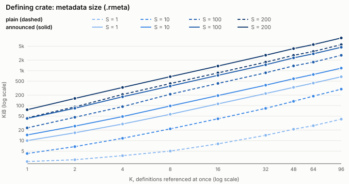
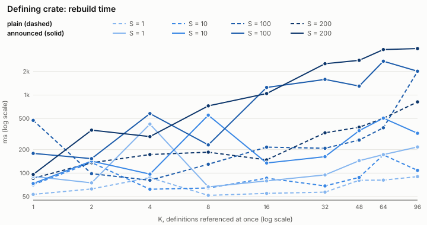
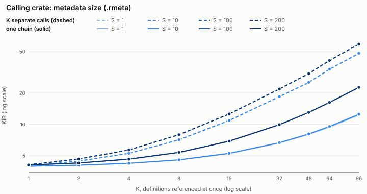
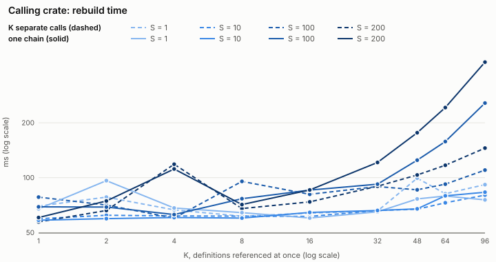

<p align="center"></p>

# announce

Make a definition visible to proc macros in any crate.

A proc macro only sees the tokens it is applied to. Put `#[announce]` on a
definition, and any crate can ask for its tokens. `#[announce]` keeps the item
and emits a `macro_rules!` with the item's name. Calling that macro passes the
definition, as tokens, to a callback macro. It works on a struct, enum, union,
trait, type alias or inline `mod`.

```rust
#[announce::announce]
pub trait Greet { fn hi(&self) -> &'static str; }

macro_rules! show {
    ([$($list:tt)*] $($key:ident)::+ ! => [$($meta:tt)*] { $($item:tt)* } $($rest:tt)*) => {
        const SHOWN: &str = stringify!($($item)*);
    };
}
Greet! { [Greet!, show!] }
assert!(SHOWN.contains("trait Greet"));
```

From another crate the call reads `path::to::Greet! { [path::to::Greet!, show!] REST }`.
The callback receives the definition, and `REST` unchanged:

```text
show! {
    [show!]
    path::to::Greet! => [META] { pub trait Greet { fn hi(&self) -> &'static str; } }
    REST
}
```

`META` lists what the definer attached (checks, `meta` entries). It is empty
without options. In the item, `#[cfg]` is already evaluated in the defining crate
and `crate::` reads `$crate::`. Callers and callbacks need no dependency on
announce.

For a struct, enum or union you write yourself, derive it instead. The derive
also implements the [`Announce`](https://docs.rs/announce/latest/announce/trait.Announce.html)
trait. Options go in a helper attribute (not `mock` or `emit_item`):

```rust
#[derive(announce::Announce)]
#[announce(meta = my_lib::info(version = 1))]
pub struct Point { pub x: i32, pub y: i32 }
```

## Crates

| crate | use it to |
|---|---|
| `announce` | define items: `#[announce]`, `#[derive(Announce)]`, trait `Announce` |
| `announce-helper` | write callbacks, start chains, redirect derives, check input |
| `announce-std` | announce std/core traits (`announce_std::iter::Iterator!`) |

A proc-macro crate that builds or rewrites items itself can make them announced
by calling `announce::machinery::announce(attr, item)` instead of emitting
`#[announce(..)]`. The result is
the same code, as `proc_macro2` tokens. If the crate's users do not depend on
`announce`, the crate re-exports it and passes `crate = ::my_lib::announce`.
`announce` also re-exports [`type_leak`](https://docs.rs/type-leak).

Minimum Rust version: 1.57 (1.56 for `announce-helper`). A `repeater` trait needs
1.59 in the defining crate.

## Calling a trampoline

```text
path::Item! { [path::Item!, other::Def!, cb!] REST }
// cb! { [cb!] other::Def! => [META] { DEF } path::Item! => [META] { ITEM } REST }
```

The list names the trampolines to call, then the callback. Each macro adds its
entry and calls the next, so `cb!` runs once, with every definition. The newest
entry comes first and `REST` is never touched. Parsers read entries greedily:
wrap a `REST` that starts like one. A list element is `path!`,
`#[derive(path)] Name` or `#[attr] Name`. A leading `(..)` group of global
options is forwarded unchanged by every hop.

## Features

- Works in any position: item, statement, expression, type, pattern, also for
  items containing `$`. The derive and attribute route works in item position only.
- Evaluates `#[cfg]` in the defining crate. `crate::` paths keep pointing there.
- Checks at the definition: `#[announce(my_lib::no_tuple_structs)]`.
- Metadata for consumers: `#[announce(meta = my_lib::info(k = v))]`.
- Transformers chosen by the caller. A transformer is a list element right after
  the definition. It rewrites the entry and forwards to the rest, for example
  `[Partly!, ::announce::signature_only!, cb!]`. Use
  [`signature_only!`](https://docs.rs/announce/latest/announce/macro.signature_only.html)
  or write your own with `announce_helper::transformer!`.
- A derive or attribute may own the name: rename the trampoline with
  `#[announce(macro_name = ParseAnnounce)]`. That derive then forwards to it with
  `announce_helper::redirect`.

## Type context

The item's tokens are used again in another crate, so its paths must resolve
there. `crate::` and absolute paths (`::std::vec::Vec<u8>`) do. A relative type
such as `Local` needs `repeater = crate::Repeater`, a trait of the defining
crate that carries the type to the callback (`announce_helper::TypeLeak::apply`).
Do not write that trait: `announce::define_repeater!(pub Repeater);` emits it
(from `type_leak::repeater_definition()`; the crate that expands it needs Rust
1.59). Const generics of every primitive type (`bool`, `char`, any integer) can
appear in a carried type. Each carried type is written from the context where it
occurs, so a method generic, a where clause or a bound that only one scope has
stays in that scope. Trait paths (supertraits, bounds) must be absolute
(`::core::fmt::Display`). The
[`#[announce]` docs](https://docs.rs/announce/latest/announce/attr.announce.html#type-context)
list what resolves, what a repeater is, and what is an error.

```text
announce::define_repeater!(pub Repeater);

#[announce(repeater = crate::Repeater)]
pub struct Holder<T> { pub a: Local, pub b: Wrap<T> }
```

A library with its own type handling announces a copy wrapped in a same-named
inline `mod`, with `emit_item = false`. Only the trampoline is emitted, not the
`mod`, so it does not clash with the real item. Modules are not analysed, so the
library makes every path resolve. The callback unwraps the module. Announcing one
item twice needs a different `macro_name` each time.

```text
#[announce(emit_item = false, meta = my_lib::info(..))]
pub mod MyTrait { pub trait MyTrait: Base { fn f(&self) -> Local; } }
```

All options are listed in the
[`#[announce]` docs](https://docs.rs/announce/latest/announce/attr.announce.html).

## Performance

Measured with the criterion benchmark in `bench/` (run `cargo bench --offline`
inside `bench/`; the full table is `bench/RESULTS.md`), on traits, with rustc
1.101 nightly on x86_64 and cargo's dev profile. S is the number of methods per
trait, K the number of definitions passed to one callback, which only consumes
its input. Sizes are of the `.rmeta` files cargo writes: item definitions and
`macro_rules!` bodies live in the metadata. Build times are the median rebuild
of that crate alone (10 samples, on a shared machine, so rough).

Lines: color = S (darker is larger), solid = announced or one chain, dashed =
plain or K separate calls. Both axes are logarithmic. Made with
`bench/plot.py --svg bench/plots`.

 
 

| S | K | definer, plain | definer, announced | calling crate, one chain | calling crate, K calls | definer build, plain / announced | calling crate build, one chain |
|---:|---:|---:|---:|---:|---:|---:|---:|
| 1 | 1 | 2.5 KiB | 13.3 KiB | 3.2 KiB | 3.2 KiB | 53 / 91 ms | 84 ms |
| 10 | 16 | 42 KiB | 303 KiB | 4.5 KiB | 10.2 KiB | 86 / 135 ms | 74 ms |
| 200 | 16 | 865 KiB | 3,081 KiB | 4.6 KiB | 10.2 KiB | 148 / 1,045 ms | 207 ms |
| 200 | 96 | 5,562 KiB | 19,045 KiB | 12.0 KiB | 47.6 KiB | 816 / 3,940 ms | 405 ms |

- The definer's `.rlib` is 2.4 KiB with or without `#[announce]`, because
  definitions contain no code. The trampoline is metadata: about 11 KiB per
  definition plus about 4 times the metadata of the item itself.
- A calling crate's `.rlib` stays 2.4 KiB. Its `.rmeta` does not depend on S and
  grows by about 0.1 KiB per definition in one chain and about 0.5 KiB per
  separate call.
- An executable that uses both crates is as large as an empty program (4,495
  KiB in the dev profile, 332 KiB stripped) at every point measured: the
  trampolines do not reach it.
- Rebuilding the announced definer costs tens of milliseconds more than the
  plain one for small definitions and several times as much at S = 200, K = 96;
  the calling crate stays within a few hundred milliseconds there.

## Related crates

- **[macro_magic](https://crates.io/crates/macro_magic)** has the same core idea:
  record an item in a macro, import its tokens by path. announce adds
  continuation lists (one callback gets many definitions), definition-side cfg
  evaluation and checks, type context handling, and a plain protocol with no
  dependency on announce.
- **[reify_types](https://crates.io/crates/reify_types)** makes a definition
  available when compiled code *runs*, not during macro expansion. announce
  delivers it at *compile time*.
